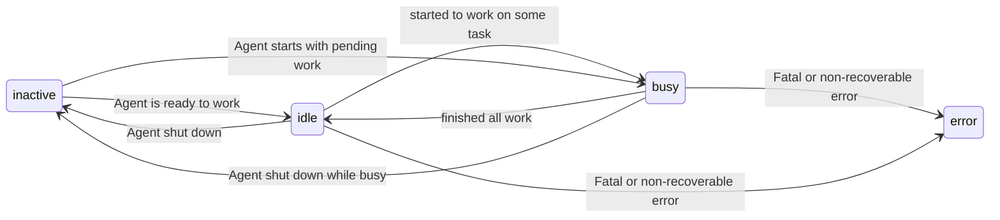
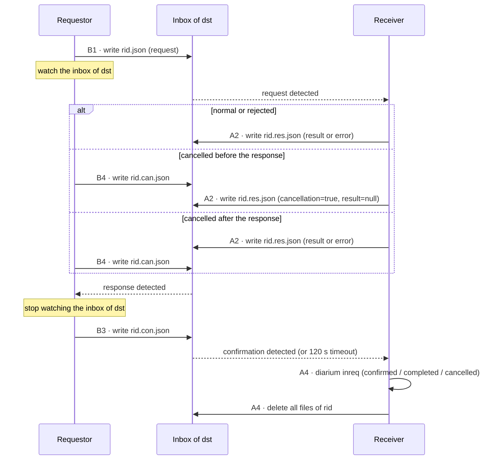
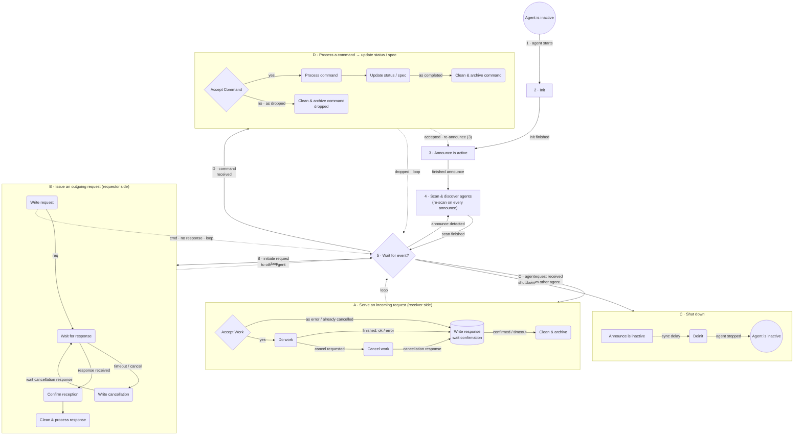

# Actio protocol

| Document | Value |
| --- | --- |
| Protocol version (`actio_version`) | 0.1 |
| Document status | Draft |
| Last updated | 2026-10-26 |
| Changes | See *Document history* at the end of the document. |

**Actio** is a simple file/object-based agent coordination protocol and tools using a single shared directory. *Actio* is harness agnostic and does not impose any specific limitation on its usage beyond using the *JSON* common message format and protocol rules and a *watchable* file system. *Actio* provides a common workspace and message passing protocol for army/team (*agmen* in Actio's terms) of agents (or other software). *Actio* is focused on trusted environments, but provides optional security features for less trusted environments (see *Security features*).


> Caveat: **Watchable** means that the implementation can monitor with high reliability changes in individual files or directories (not recursive). Local file systems using kernel watch (FSEvents, inotify) mechanisms are ideal, but other implementations using object stores (S3,...), polling algorithms or sync software (unison, mutagen) are feasible. Other storages such as DBs, key-value stores or even brokers could be adapted to the protocol but are not the objective of the protocol, which is file focused.

## The protocol

### Actio **principles**

- **Peer to Peer**: Each agent is independent of each other. The protocol does not assume any hierarchies or dependencies.
- **Direct communication**: The protocol is strictly based on request-response protocol. One agent (the requestor) requests and the receiving agent (the receiver) responds. No broker or intermediate is needed.
- **Communication not orchestration**: *Actio* enables agent communication but does not cover orchestration between agents.
- **File system based**: Only files and folders are used for agents to communicate following the protocol rules.
- **High Latency & Low Throughput**: The protocol is not designed to manage a high number of requests from one agent to another with low response latency. The typical scenario is that requests and responses will take seconds or minutes to complete.
- **Minimal shared state**: Agents do not share state, only the ```nuntium``` folder, where each agent writes its own announce file to **announce** changes, and a single folder for each agent.
- **Minimal planning**: The protocol only requires a **Unique agent ID** (maximum length of 32 characters)
- **Strict format**: The protocol is strict regarding format. Any file or object that does not conform to the protocol schemas is invalid and **ignored** by the receiver: it does not trigger any acceptance test, generates no response and produces no state change. Receivers never repair, normalize or guess missing fields; senders are fully responsible for producing well-formed files.
- **Reasonable time sync**: The protocol assumes that all parties have reasonably synchronized clocks, as status ages and timeouts are computed from timestamps written by other agents. Clock skew is not managed by the protocol.

### Terminology

- **Agent ID**: the unique identifier of an agent, declared in its `spec.json` (`id`).
- **Requestor**: the agent that issues a request or a command (`src` in the header).
- **Receiver**: the agent that receives it; all files of the exchange are written in its `inbox` (`dst` in the header).
- **Exchange**: all the files of one `rid`.
- **Envelope**: any of the four files of an exchange: request file, cancellation, response, confirmation.
- **Request file**: `<rid>.json`, which carries either a request or a command.
- **Request** / **command**: an exchange with `type="req"` (a call to a capability) / `type="cmd"` (a command).
- **Message**: used only in the security sections, as a synonym of envelope.
- **Status**: the agent status written by the agent in `status.json` (`inactive`, `idle`, `busy`, `error`).
- **Health**: derived by other agents from the status and its age (`healthy`, `online`, `degraded`, `zombie`).
- **Final status**: the outcome of an exchange recorded in the diarium (`final_status`): on the receiver side (`inreq`) `cancelled`, `completed`, `confirmed`, `dropped`; on the requestor side (`outreq`) `confirmed`, `cancelled`, `abandoned`, `sent`.
- **Archive**: the end of an exchange on the receiver side (see *Envelope lifecycle*).

### Conventions

The key words "MUST", "MUST NOT", "REQUIRED", "SHALL", "SHALL NOT", "SHOULD", "SHOULD NOT", "RECOMMENDED", "NOT RECOMMENDED", "MAY", and "OPTIONAL" in this document are to be interpreted as described in BCP 14 (RFC 2119, RFC 8174) when, and only when, they appear in all capitals, as shown here.

- Normative text: the sections of *The protocol*, including its notes, except the examples.
- Non-normative text: *Implementation guidance*, *Appendix A — Worked examples*, the examples, and the diagrams (the text prevails when a diagram differs).
- The annotated `json` blocks are proformas for human readers: they contain comments and placeholders. In them, "mandatory" means that the field MUST be present and "optional" that it MAY be absent. The formal definitions are the schema files (see *Schemas*).
- All durations are in seconds (see *Timers and thresholds*).

### Assumptions and non-goals

The protocol assumes that:
- All agents of a team (*agmen*) share a single `.actio` root that every agent can read, and every agent can write into the `inbox` of the other agents, into `nuntium` and into `forum`. The file system is the trust boundary; *Actio* is focused on trusted environments, and the optional security features (see *Security features*) protect the content of the exchanges, not the file system.
- One `.actio` root serves one team.
- Agent IDs are unique (see *Agent Spec*); the protocol cannot control it.
- Clocks are reasonably synchronized (see *Actio principles*); clock skew is not managed.
- The storage is *watchable* (see the caveat in the introduction).

The protocol does not cover:
- **Orchestration**: *Actio* enables communication between agents, not orchestration (see *Actio principles*).
- **Delivery and ordering guarantees**: there are no locks, no delivery guarantees and no ordering between exchanges. Races are possible and their probability is considered low at the slow pace of the protocol (see *Sync and Race Conditions*). If reliability is critical, the protocol is not suited for the application, or it can be used as an unreliable layer with synchronization control implemented at a higher level.
- **Pending envelopes of an inactive agent**: if the inbox holds envelope files written while the agent was inactive, the protocol does not define what happens to them when the agent becomes active again. Each implementation decides depending on its objectives.
- **Starting an agent that is not running**: how an agent that is not running is started (launcher, supervisor, manual start) is outside the protocol. A running agent can only be asked to stop or restart itself (`stop`, `restart`).
- **Duplicates, orphan and stale files**: the protocol does not impose any control on duplicate requests (an envelope with a `rid` already processed), on orphan files/objects (e.g. a confirmation written after the confirmation timeout, or a cancellation written after the request was archived) or on stale files (e.g. the announce file `nuntium/<agent_id>.n.json` or the folder of an agent that never comes back). Each implementation decides how to detect and clean them.
- **How files are written**: the protocol does not impose how files are written atomically, nor sizes, quotas or diarium rotation; these are implementation choices (see *Implementation guidance*).

### Actio directory structure

**Actio** uses a single folder with the following structure (by default ```<home>/.actio``` but SHOULD be configurable by the protocol implementation). The structure is simple:

```
.actio
   |
   - actio.json : Optional team-level metadata, read-only for agents (see *Team metadata*).
   |
   - tools : Optional actio tools and helpers for agents. (not mandatory)
   |
   - nuntium : Mandatory announce folder.
   |    |
   |    - <agent_id>.n.json --> Announce file of an agent, written only by that agent on every announce.
   |    |
   |    - nuntium.json --> Broadcast signal reserved for special cases (central orchestrator, debug, monitoring tools...). Agents do not write it. Same format as the announce files.
   |
   - forum : Optional shared folder for file interchange, writable by all agents. (not mandatory) Attachments are listed in requests and responses by their path relative to `forum`; the protocol does not mandate any sub-folder layout.
   |
   - <agent-folder 1st>: One folder per agent (recommended name: the agent ID). The owning agent writes spec.json, status.json and diarium.jsonl; other agents can read them. Other agents write request files into inbox (see Requests).
   |    |
   |    - spec.json --> Information disclosed by the agent to other agents. Declares the agent ID.
   |	|
   |	- status.json --> Information about the status of the agent.
   |    |
   |    - inbox -->  The inbox of the agent. Each request uses up to four envelope files (see Requests).
   |    |   |
   |    |   -  <rid>.json : Request file, written by the requestor.
   |    |   |
   |    |   -  <rid>.can.json : Cancellation file, written by the requestor.
   |    |   |
   |    |   -  <rid>.res.json : Response file, written by the receiver.
   |    |   |
   |    |   -  <rid>.con.json : Confirmation file, written by the requestor.
   |    |   |
   |    |   -  <other rid>.json 
   |    |   |  ...
   |    |       
   |    - diarium.jsonl: Log file where relevant past events are stored for audit and control.
   |
   |- <agent-folder 2nd>
   |      . . .
   |- <agent-folder 3rd>
   |      . . . 
   |      . . .
   |- <agent-folder N>
   |     . . .
   |     . . .
```

The folder names `tools`, `forum` and `nuntium` are reserved and cannot be used as agent folders. The protocol recommends naming each agent folder with the agent ID but does not enforce it: the agent ID is the one declared in its `spec.json`, and the inbox of an agent is the `inbox` folder inside the folder whose `spec.json` declares that ID.

Any agent creates the `.actio`, `nuntium` and `forum` folders if they do not exist when it needs them. Each agent creates its own folder and its `inbox` (see *Announcement and Discovery*).

Ownership of every file and folder (every agent can read every file):

| File / folder                      | Created by                    | Written by                                              | Deleted by                                   |
| ---------------------------------- | ----------------------------- | ------------------------------------------------------- | -------------------------------------------- |
| `.actio/`                          | any agent, when needed        | —                                                       | not defined by the protocol                  |
| `actio.json`                       | not defined by the protocol (e.g. whoever sets up the team) | never written by agents (read-only) | not defined by the protocol |
| `tools/`                           | not defined by the protocol   | not defined by the protocol                             | not defined by the protocol                  |
| `nuntium/`                         | any agent, when needed        | —                                                       | not defined by the protocol                  |
| `nuntium/<agent_id>.n.json`        | the announcing agent          | only that agent, on every announce                      | not controlled (stale files)                 |
| `nuntium/nuntium.json`             | special tools (orchestrator, debug, monitoring) | special tools only; agents never write it | the tool that wrote it                       |
| `forum/`                           | any agent, when needed        | —                                                       | not defined by the protocol                  |
| Request attachments in `forum`     | the requestor (`B1`)          | the requestor                                           | the requestor (`B5`, or when it gives up in `B2`) |
| Response attachments in `forum`    | the receiver (`A2`)           | the receiver                                            | the receiver (archive, `A4`)                 |
| Agent folder                       | the owning agent (announce step 1) | —                                                  | not controlled (stale files)                 |
| `spec.json`                        | the owning agent              | the owning agent                                        | not defined by the protocol                  |
| `status.json`                      | the owning agent              | the owning agent                                        | not defined by the protocol                  |
| `diarium.jsonl`                    | the owning agent              | the owning agent (append only)                          | not defined by the protocol                  |
| `inbox/`                           | the owning agent (announce step 5) | —                                                  | not defined by the protocol                  |
| Envelope files in `inbox`          | see *Envelope lifecycle*      | each file has a single writer and is written once       | the receiver (archive)                       |

#### Team metadata

`.actio/actio.json` is an optional file with team-level metadata. It is read-only for agents: agents MAY read it and MUST NOT write it. How it is created and maintained (e.g. by whoever sets up the team) is not defined by the protocol. All fields are optional:

```json
// Proforma team metadata
{
  "actio_version": "<major>.<minor>", // optional version of the Actio protocol used by the team (informative, same format as in spec.json and the envelope header)
  "description": "text describing the team", // optional
  "metadata": { ... } // optional JSON object with free content, not subject to any schema
}
```

Like any other file, an `actio.json` that does not conform to its schema is ignored (*Strict format*).

### Announcement and Discovery

When an agent wants to join the team it MUST follow these steps to announce its activation:

1. Create the agent's folder inside the ```.actio``` directory if it does not exist. The recommended folder name is the agent's ID (not enforced; `tools`, `forum` and `nuntium` are reserved).
2. Inside the agent's directory write the agent's specification: ```spec.json```
3. Inside the agent's directory write the agent's status: ```status.json``` setting the ```status="idle"```, or ```status="busy"``` if the agent starts with pending work (see *Agent's status*)
4. Inside the agent's directory add a new line to register an event in ```diarium.jsonl```
5. Inside the agent's directory add a new directory ```inbox``` if it does not exist.
6. Write its announce file ```.actio/nuntium/<agent_id>.n.json``` to announce the registration to other agents.

Conversely, when an agent wants to announce that it is inactive it MUST proceed in the same way, with the difference that ```status``` in ```status.json``` is set to "inactive" (or "error", see the note on the `error` status after the workflow).

All agents after registration watch the folder ```.actio/nuntium``` and, whenever a file in it is created or modified (an agent's announce file or the broadcast ```nuntium.json```), MUST proceed as follows:

1. Scan all subdirectories inside ```.actio``` excluding the reserved "tools", "forum" and "nuntium" folders.
2. For each subdirectory inspect if ```status.json``` and ```spec.json``` files exist. If they don't, ignore the directory.
3. If ```status.json``` or ```spec.json``` don't comply with their schemas (see *Schemas*), ignore the directory.
4. Process ```status.json``` and ```spec.json``` to discover the agent's capabilities and current status.

Any creation or update in the `nuntium` folder triggers a complete scan of all agent folders and updates the internal view of all agents.

The announce file `<agent_id>.n.json` is a JSON object with four fields, all mandatory:

```json
// Proforma announce file
{
  "id":"<agent id>", // mandatory ID of the announcing agent
  "datetime":"YYYY-MM-DDThh:mm:ssZ", // mandatory time of the announce
  "ts": number, // mandatory timestamp of the announce (Unix epoch seconds)
  "nuntium":"text with the news" // mandatory, e.g. "agent is active", "spec updated"
}
```

The broadcast file `nuntium/nuntium.json` uses the same format.

The files in the `nuntium` folder are **signals only**: any creation or update of an announce file or of `nuntium.json` triggers a complete scan, and `nuntium.json` can be used as a broadcast signal to all agents. Agents MAY read the content of these files to apply their own internal logic to the information published; the protocol does not define any meaning or required action for that content.

### Agent Spec

Agent's spec is a publication of agent capabilities. What the agent can do and how it helps. The following general rules apply to all specs:

- **ID** is a string of up to 32 characters matching ```[a-zA-Z0-9\_\-]+```. **It MUST be unique**. Uniqueness is a prerequisite of the protocol: the protocol cannot control it, and each implementation decides what to do if two agent folders declare the same ID.
- **Namespace**: Namespaces are logical separations within a team. This is useful to control which agents can call each other inside a team. An agent can be part of multiple namespaces and can call the agents that share at least one namespace with it. Rules:
	- If `namespaces` is absent, `null` or an empty list, the agent belongs to the `null` namespace.
	- If it is filled (e.g. `["ns1"]`), the agent does **not** belong to the `null` namespace. To include it, `null` MUST be listed explicitly: `["ns1", null]`.
	- `null` is the JSON literal `null` (the void namespace), not the string `"null"`.
	- The special value `"*"` means that the agent belongs to all namespaces. It can be combined with other values; the combination is redundant but valid.
- **Description** is a key piece of information to explain to other agents what is the agent mission and how can it help to the team. It SHOULD be unambiguous and concise.
- **Capabilities**: An agent can provide a set of capabilities that can be used by other agents. The set can be empty: an agent with no capabilities only takes part as a requestor (and as a receiver of commands). Agent capabilities are defined using OpenAI's tool calling definitions including also a ```result``` field with a JSON schema of the result provided by the agent and some additional fields. A capability can be downgraded to a tool schema only by removing the additional fields. The capability id MUST be unique for an agent and MUST follow ```[a-zA-Z0-9\_\-]+``` regex. Inside a team a capability has a unique identifier defined by the agent-id + capability name. String notation of a capability is ```agentid/capability_name```.
- **Protocol version**: `actio_version` uses the format `"<major>.<minor>"` (e.g. `"0.1"`), in `spec.json` and in the envelope header. It is informative: the protocol does not define compatibility rules between versions.
- **Dependencies**: Define hard dependencies (dependencies) and optional dependencies (wants).
- **Security**: The security attributes are opt-in to the protocol via the `security_support` and `security_posture` fields. If the agent supports cryptographic features, publish its public keys in case message signing/encryption is used.
- **Harness hints**: `skill`, `tool`, `tool_name` and `sync` in the `actio` object of a capability are hints for the harness that exposes the capabilities of other agents (e.g. as LLM tools). They have no effect on the protocol.
- **Info**: Additional info to share not enforced by the JSON schema that can be used for user specific metadata and protocol expansion.

JSON VIEW:

```json
// Proforma specification
{
  "id":"agent ID",// mandatory ID
  "actio_version": "<major>.<minor>", // mandatory version of the Actio protocol (informative)
  "datetime":"YYYY-MM-DDThh:mm:ssZ", // mandatory Last time spec was updated
  "description":"short text describing what the agent can do", // mandatory
  "namespaces":["ns1","ns2",.... ], // Optional. If absent, null or empty, the agent belongs only to the "null" namespace. null can be listed explicitly, e.g. ["ns1", null]. "*" means all namespaces.
  "depends": [ "agent id 1" , "agent id 2", .. ], // Optional defaults to empty list
  "wants": [ "agent id 1" , "agent id 3", .. ], // Optional Like 'depends' but no hard requirement to run. Optional defaults to empty list
  "disabled": bool, // Optional , flag the agent as disabled if not set disabled=false. Changed with the `enable` command.
  "accepts_commands_from": [ .. list of agent IDs from which it accepts commands ...], // Mandatory. Only agents in this list can send commands; an empty list means nobody.
  "capabilities":[ // Mandatory. Can be empty if no capabilities are offered to the team
     ... //Each capability is similar to an OpenAI tool definition plus some additional fields
     {
       "name":"short name of capability ", // mandatory restricted to '[a-zA-Z0-9\_\-]+' is the capability ID
       "description":"description of the capability", // mandatory
       "parameters": {  // mandatory but can be empty
            ... // JSON objects with OpenAI's tool calling parameter format.
       },
       "actio": {
         "result": { // Mandatory 
	         // JSON schema with the result's format
         },
         "skill": "Skill like additional documentation on how to use the capability", // optional harness hint, no protocol effect
         "tool": bool, // optional harness hint, no protocol effect: recommends capability users to expose this capability as an individual tool.
         "tool_name": "tool_name",  // optional harness hint, no protocol effect: suggested tool name in case tool = true
         "sync": bool, // optional harness hint, no protocol effect: recommends that the caller waits for the response before continuing (synchronous use).
         "accepts_from": [ .. list of agent IDs .. ], // Optional. If absent or empty, every agent can use this capability; otherwise only the listed agents.
         "max_parallel": number, // optional max number of parallel requests the agent supports. 0: unbounded. Managed by the receiver: how it handles requests above the limit (e.g. queue them or reject them with code 107) is up to the receiver.
         "recommended_timeout": number,  // optional recommended timeout for response, in seconds 
         "disabled": bool,   // optional the capability is disabled or unavailable. Do not call if set; it will fail.
       },
      
     }
     ...
  ],
  "security_support": [ "sign" , "encrypt", "issuer_sign" ], // mandatory list of security features if empty, no security features are supported 
  "security_posture": "trusted|untrusted|secret|zero-trust", // Mandatory for security posture 
  "security":[ // optional for security attributes
      ...
      {"key":"ed25519|x25519", "value":"raw base64 string with the public key"}, // key and values are mandatory (example of keys)
      {"key":"issuer_id", "value":"id of the issuer"},   // key issuer id of the certificate for zero-trust
      {"key":"issuer_cert", "value":"raw base64 string with the issuer certificate" } // issuer certificate
  ],
  "info": { // Optional extra information, all fields are optional and are not subject to strict schema definition.
       // Some examples but not enforced.
	  "long_description":"Longer extra description",
	  "author":"author of the agent",
	  "model":"llm used by the agent if any",
	  "standalone": bool, // true if it can operate autonomously.
	  ... other fields, free and not schema validated...
  }
}

// Example of a minimal agent spec
// For a text summarizer agent without additional capabilities.
{
  "id":"summarizer",
  "actio_version": "0.1",
  "datetime":"2026-01-02T12:12:00Z",
  "description":"Fast summarization of text with summarization instructions",
  "accepts_commands_from": [],
  "security_posture": "trusted",
  "security_support": [],
  "capabilities":[
	{ "name":"summarize",
	  "description":"Perform fast summarization of text with instructions and additional context",
	  "parameters":{
		  "type":"object",
		  "properties":{
			  "text":{"type":"string","description":"the text to summarize"},
			  "instructions":{"type":"string", "description":"instructions to perform the summarization, e.g. focus, structure, etc."},
			  "context":{"type":"string","description":"additional context to add to the summarization task"}
		  },
		  "additionalProperties": false,
		  "required": [ "text" ]
	  },
	  "actio": {
		  "result":{"type":"string", "description":"summarized text" }
	  } 
	}
  ]
}
```

#### Security features
The agent MUST expose two fields `security_support` and `security_posture` to inform how the agent supports and requires security capabilities of the protocol. The `security` list of key-value pairs stores information needed by the protocol. Implementing security is optional in the protocol. 

Each agent declares which security features it implements:
- sign: Can send signed requests and receive signed requests from other parties with no central issuer and therefore vulnerable to man-in-the-middle attacks.
- encrypt: Can decrypt and encrypt messages and attachments.
- issuer_sign: Implements a validation of agents' keys via a certificate issued by a central issuer.
 
The agent also declares a security posture. Postures form a ladder: trusted < untrusted < secret < zero-trust.
1. trusted: The agent will accept any message and does not validate the identity of the sender; messages are not encrypted. Requires no security features; for controlled environments.
2. untrusted: The agent will not accept any unsigned message and will validate the message signature. Messages are not encrypted and are visible to anyone. Requires 'sign' support on both sides.
3. secret: The agent will not accept any unsigned message and will validate the message signature. Messages MUST be encrypted. Requires 'sign' + 'encrypt' support on both sides.
4. zero-trust: The agent will not accept any unsigned message and will validate the message signature and issuer certificate. Messages MUST be encrypted. Requires 'sign' + 'encrypt' + 'issuer_sign' support on both sides.

Rules of the security posture:
- The posture is defined by the receiver of the request and is one-way: it is neither commutative nor transitive. When agent A sends a request to agent B, only B's posture applies, whatever A's own posture is.
- The level applies to all messages of the exchange: request, cancellation, response and confirmation.
- The requestor MUST support and use the security features of the receiver's posture level, or of a higher level if the receiver supports the features of that level. In practice, a simple implementation matches the receiver's level.
- Once encryption is in use (secret, zero-trust), all attachments of the exchange MUST also be encrypted, both request and response attachments.
- Encryption applies to the body of each file only. The header (`rid`, `src`, `dst`, `datetime`, `type`, `actio_version`) is public and contains only metadata.
- Each file is signed by its writer: request, cancellation and confirmation by the requestor; response by the receiver.

Example: agent B has posture `untrusted` and supports `sign` and `encrypt`. Agent A must use `untrusted` or `secret` mode, as B supports both signing and encryption, but cannot use `zero-trust`, as B does not support `issuer_sign`. A naive but valid implementation simply uses `untrusted`.


#### Callability rules

Once an agent (A) scans the specification and status of another agent (B), it will apply the following rules to check if A can send requests/commands to agent B:
1. Disable filter: If agent B's spec has `disabled=true`, agent A will not consider agent B's capabilities. Commands can still be sent, so that the agent can be enabled again (`enable` command). Disabling only affects new requests: requests already accepted by agent B continue normally.
2. Namespace filter: If agents A and B do not share at least one namespace (an agent in the `"*"` namespace shares a namespace with every agent), agent A will not consider agent B's specification.
3. Security posture filter: If agent A does not support the security features required by agent B's security posture, agent A will not consider agent B's specification.
4. Security issuer filter: If agent B requires 'zero-trust' security, agent A will verify that it is in possession of the required issuer key; if not, agent A will not consider agent B's spec.
5. Command and Capability filters: Analyze the spec and fill a `command` flag  and `capabilities` list.
	1. Command filter: If agent A's ID is in agent B's `accepts_commands_from`, agent A will flag `command=true` (an empty `accepts_commands_from` means that nobody can send commands).
	2. Capability filter: Each capability listed in agent B's spec is tested for `disabled=true` and `accepts_from`. If not disabled and `accepts_from` is absent, empty or contains agent A's ID, the agent will add it to the `capabilities` list; otherwise the capability is ignored.
6. If the previous filters show that no commands and no capabilities are usable by agent A, agent A will discard agent B.
7. Status filter: Agent A checks agent B's status and filters out agents with status "inactive" or "error", as they will not respond.
8. Health flags: Agent A flags, but does not filter out, agents whose health (see *Agent's status*) is "degraded" (last status update more than 100 s ago) or "zombie" (more than 600 s ago). The protocol does not impose any restriction on them: it is up to each agent to decide whether calling a "degraded" or "zombie" agent is in line with its objectives. 

After applying the callability rules, the scanning agent (A) will have a clear view of how to interact with agent (B). In particular:
- Agent B's ID.
- Agent B's security posture: How requests should be submitted, including the security parameters needed, e.g. keys.
- Agent B's command flag: If agent B is accepting commands from agent A.
- Agent B's list of usable capabilities: List and specifications of all usable capabilities.

Agents can see all agents, but the protocol imposes these rules to be able to call them, and they MUST be enforced by the implementation. An agent MAY also call itself (send requests or commands to its own inbox): the protocol does not inhibit it.

### Agent's status

Each agent can implement its internal state in line with its own requirements. The protocol imposes as **mandatory** the following states to be notified:



The transitions `busy → inactive` and `inactive → busy` are possible and depend on the internal logic of the agent; the protocol does not enforce any rule on them.

Agents MUST also respect the following rules regarding agent status updates imposed by the protocol:

1. update field ```status``` in ```.actio/<agent folder>/status.json``` with a valid status string "inactive | idle | busy | error" and ```datetime``` with the ISO 8601 date UTC.
2. When the status changes between an active state ("idle", "busy") and a non-active state ("inactive", "error"), the agent's announce file ```.actio/nuntium/<agent_id>.n.json``` MUST be written, as a delayed write after updating the agent's ```status.json```. An agent that fails abruptly may not be able to announce; peers then see it through its health.
3. The agent MUST update its status immediately after a state change and at least once every 90 seconds even if the status did not change. This leaves a margin before the 100 s threshold: other agents see the health of a compliant agent as "healthy" or "online". Whether a peer sees it as "degraded" also depends on when that peer reads the status.
4. If an "idle" or "busy" agent has updated its status less than 60 seconds ago, its health is "healthy".
5. If an "idle" or "busy" agent has updated its status between 60 and 100 seconds ago, its health is "online".
6. If an "idle" or "busy" agent has updated its status between 100 and 600 seconds ago, its health is "degraded".
7. If an "idle" or "busy" agent has not updated its status for more than 600 seconds, its health is "zombie".
8. If status is "error" or "inactive", the agent is not required by the protocol to respond to any envelope.

The **health** of an agent (rules 4–7) is not written by the agent: other agents derive it from its `status` and the age of its `datetime`. Any agent MAY read the status of other agents at any time; the protocol does not impose when.

Additional status info is supported by the protocol but is not mandatory to be provided:
 - msg: Last human-readable status message to report it status.
 - tasks: List of internal task (see *Schemas*). Agents are free to disclose when and how to disclose tasks, the protocol does not require notifying this information.
 - load: % of the estimated load of the agent.
 - contention: true|false if the agent is in contention.

The additional information can be used by the agent to plan adequate behavior to interact with other agents. For example, an agent can choose to check if the other agent is in contention or has excessive load before submitting a request and wait (or route to other agent) depending on the final objectives and logic of each agent.

Examples of agent's status JSON Layout:
```json
// Proforma view; the formal definition is schemas/status.schema.json (see *Schemas*).
{
  "id":"<agent id>", // mandatory
  "status":"inactive|idle|busy|error", // mandatory
  "datetime":"YYYY-MM-DDThh:mm:ssZ", // mandatory
  "msg":"last human-readable status msg", // Optional
  "load": number, // Optional % of the estimated load of the agent
  "capability_status": [ // Mandatory
	  {"name": "capability name" , "running": number , "queue": number } // for each capability one object with the number of requests running and in queue
  ],
  "tasks": [ // Optional of internal agent tasks.
      { 
        "capability": "capability name", // mandatory if the task is present.
        "name": "<task_name or id>", // Optional agent's internal reference name or id
        "title":"task short description", // Optional short description
        "status": "pending|running|waiting|completed|cancelled", // Mandatory if the task is present
        "progress": number, //Optional 0 to 100 % progress
        "eta": "hh:mm:ss", // Optional ETA estimation
      },
      ...more tasks...
  ],
  "contention": bool  // Optional for signaling consumers to wait before submitting requests.
}

// Real Examples
{
  "id":"summarizer",
  "status":"idle",
  "datetime":"2026-08-10T10:20:40Z",
  "capability_status": [
	  {"name":"summarize","running":0,"queue":0}
  ]
}
```


### Requests

Communication between agents in the protocol lives in simple requests. Requests can be of two kinds:

1. Commands: Simple actions to manage the general behavior of the agent. Commands are used to stop, enable/disable, restart, ping, ... the agent and do not provide direct feedback of success or failure. In general sending a command will trigger a change of state and/or spec. Only commands sent by agents listed in `accepts_commands_from` are accepted; otherwise any command is dropped.
2. Request: are function calls to the capabilities offered by an agent to other agents of the team. Each request has a deterministic workflow. The protocol enables mutual confirmation of the request.

For the complete lifecycle of a request, see the workflow below.

#### Issue a request

Requests and commands share the same JSON envelope format. An exchange is made of up to four envelope files, all written in the `inbox` of the destination agent (the `inbox` folder inside the folder whose `spec.json` declares the `dst` ID). Each file has a single writer:

| File (recommended name) | Body key       | Written by | Content                           |
| ----------------------- | -------------- | ---------- | --------------------------------- |
| `<rid>.json`            | `request`      | requestor  | The request or the command.       |
| `<rid>.can.json`        | `cancellation` | requestor  | The cancellation of the request.  |
| `<rid>.res.json`        | `response`     | receiver   | The response to the request.      |
| `<rid>.con.json`        | `confirmation` | requestor  | The confirmation of the response. |

All files of an exchange share the same header as the original request; only `datetime` changes (the time each file is written). The header is part of the request: in all four files `src` is the requestor and `dst` the receiver, including the response written by the receiver. The header is never encrypted: it is public and contains only metadata. Each file is signed by its writer: the request, the cancellation and the confirmation by the requestor, and the response by the receiver. The file names are recommended but not enforced by the protocol: the request is identified by the `rid` field of the header, and the kind of file by its body key. When watching an inbox, implementations MUST keep track of ongoing requests to match each new file with its request. Each envelope file is written once and never modified afterwards. Commands (`type="cmd"`) only use the request file and cannot be cancelled.

The request file:

```json
// Request envelope is a file/object in json format.
{
// Header section. All fields mandatory. Shared by all files of the exchange (only datetime changes).
"rid":"<unique request ID>", // Mandatory generated by the requestor.
"src":"<source agent_id>", // Mandatory ID of the requestor
"dst":"<dest agent_id>", // Mandatory ID of the receiver agent
"datetime":"YYYY-MM-DDThh:mm:ssZ", // mandatory time the file was written
"type":"cmd|req", // mandatory command or request
"actio_version":"<major>.<minor>", // mandatory version of the Actio protocol used by the requestor (informative)

// Request body. This can be base64 string (if encryption is enabled) that when decrypted is a JSON object with the body. The header is never encrypted.
// request body, all fields are mandatory
"request": {
    "ts": number, // Mandatory timestamp of the request (Unix epoch seconds).
    "nonce":"128bit hex nonce of the request", // Mandatory generated by the sender
    "signature":"base64 signature of the request", // Mandatory. Signed by the requestor. For security posture=trusted the value is not considered and can be null.
    "name":"<command/capability id>", // Mandatory. If type="cmd" is the command name/id if type=req is the capability name/id.
    "parameters":{ ... parameters of the request  }, // Mandatory. If there are no parameters it MUST be null.
    "timeout": number_seconds, // Mandatory, requestor timeout for the task. 0=no timeout.
    "attachments": [...]   // Mandatory. List of files/objects in the forum folder associated with this request, as paths relative to forum (encrypted when encryption is in use). can't be null but can be an empty list
}
}
```

#### Cancellation 

Once the request file has been received by the receiver (see workflow below), the receiver starts working on the request asynchronously. The requestor MAY cancel a request (`type="req"`; commands cannot be cancelled) by writing the cancellation file `<rid>.can.json`, with the same header and a `cancellation` body:

```json
{
//... same header as the request, with its own datetime ...
// Cancellation body is an object, or a base64 string that decrypts to a JSON object when encryption is in use.
"cancellation": {
   "ts": number, // Mandatory timestamp of the cancellation request (Unix epoch seconds) 
   "nonce":"128bit hex nonce of the cancellation request", // Mandatory generated by the sender
   "signature":"base64 of the signature of the cancellation request", // Mandatory. Signed by the requestor. Can be null if not needed
   "name":"<name/id of the capability>", // Mandatory. MUST be the same as the `name` in the request
   "force": bool  // Forceful cancellation to be as fast as possible, interrupting ongoing process forcefully.
}
}
```

When a cancellation is requested, the requestor keeps waiting for the response, which it confirms as usual; the request attachments are deleted after the confirmation (`B5`), as in the normal workflow. The result of that response, if any, can be discarded. As for a request, the wait is bounded by a requestor timeout: if no response arrives before it expires (e.g. the receiver is inactive), the requestor gives up, stops watching the destination inbox and deletes its request attachments.

The receiver always answers a cancellation with a response, and the exchange always ends with a confirmation (or the confirmation timeout). The receiver handles the cancellation depending on when it detects it:
- Before accepting the request (`A0`): no work is started. The receiver writes a *cancellation response* (`error=false`, `cancellation=true`, `result=null`), and waits for the confirmation (`A2`). The cancellation response acknowledges the cancellation; it is not an error.
- While working: the work is stopped and cleaned. The receiver writes a cancellation response and waits for the confirmation (`A2`).
- After the response file has been written: no second response is written (envelope files are written only once). The requestor confirms the existing response as usual.

In all cases, the request is archived as `cancelled` (`A4`) after the confirmation or the confirmation timeout.

Recommendations on timeouts are in *Implementation guidance*.

#### Response

Responses are only generated in case the request is type="req"; commands do not generate responses but cause changes in the state of the request's receiver. When the receiver has finished the job (even with an error), or when it receives a cancellation before writing the response, the receiver writes the response file `<rid>.res.json` in its own inbox, with the same header and a `response` body:

```json
{
//... same header as the request, with its own datetime ...
// Response body is an object, or a base64 string that decrypts to a JSON object when encryption is in use.
"response":{
   "ts": number, // Mandatory timestamp of response (Unix epoch seconds) 
   "nonce":"128bit hex nonce of the response", // Mandatory generated by the receiver
   "signature":"base64 of the signature of the response", // Mandatory. Signed by the receiver. Can be null if not needed
   "error": bool, // Mandatory. The response is an error. false for a cancellation response (an acknowledgement, not an error).
   "cancellation": bool, // Mandatory. true if this is a cancellation response (the acknowledgement of a cancellation); then error=false and result=null.
   "result": {  // Mandatory. Result of the work MUST follow the capability response schema. If an error, follow the *request error schema*. null for a cancellation response.
   },
   "attachments": [...],  // Mandatory. List of files/objects in the 'forum' folder associated with this response, as paths relative to forum (encrypted when encryption is in use). can't be null but can be an empty list (empty for a cancellation response)
   "work_time": number, // Optional Seconds required by the receiver to compute the result. This is the actual work and does not include waiting times.
}
}
```
Note: Response attachments are different from request attachments. The receiver cleans these files from the `forum` folder when it archives the request (see `A4`).

In case of error, the `result` field MUST follow this JSON schema, `schemas/error.schema.json` (a cancellation response is not an error: `error=false` and `result=null`):
```json
{
  "$schema": "https://json-schema.org/draft/2020-12/schema",
  "title": "ActioErrorResponse",
  "type": "object",
  "properties": {
    "code": {
      "type": "integer",
      "description": "Optional error code. Requests rejected at A0 use the standardized codes (see *Acceptance errors*)."
    },
    "msg": {
      "type": "string",
      "description": "Error message"
    },
    "details": {
      "type": "string",
      "description": "Error details "
    }
  },
  "required": [
    "msg"
  ],
  "additionalProperties": false
}
```

##### Acceptance errors

`code` is optional in the error schema. When the receiver rejects a request at `A0`, the error result includes the standardized `code` from the table below. Commands are never answered, so they have no codes. Errors produced by the work itself are capability errors: each agent defines its own codes (≥ 1000), if any. Files that do not conform to the schemas are ignored (*Strict format*) and are never answered.

Code ranges:

| Range         | Use                                                                                    |
| ------------- | -------------------------------------------------------------------------------------- |
| 100–199       | Acceptance errors defined by the protocol (`A0`).                                      |
| 200–299       | Security acceptance errors. Reserved; defined with the security specification (*Security*). |
| 300–399       | Work errors defined by the protocol: an accepted request that ends without a result for a reason that is not the capability's own. |
| 1–99, 400–999 | Reserved for future protocol use.                                                      |
| ≥ 1000        | Capability errors, free for each agent.                                                |

Acceptance error codes:

| Code | Name                    | When                                                                                                  | Check    | Retry (guidance)                        |
| ---- | ----------------------- | ----------------------------------------------------------------------------------------------------- | -------- | --------------------------------------- |
| 100  | `agent_disabled`        | The receiver's `spec.json` has `disabled=true`.                                                       | Required | Later, once the agent is enabled again. |
| 101  | `unknown_capability`    | The receiver has no capability with this `name`.                                                      | Required | No.                                     |
| 102  | `capability_disabled`   | The capability has `disabled=true`.                                                                   | Required | Later.                                  |
| 103  | `requestor_not_allowed` | The capability's `accepts_from` is not empty and does not list `src`.                                 | Required | No.                                     |
| 104  | `version_not_supported` | The receiver does not support the header `actio_version` (the protocol defines no compatibility rules; each receiver decides). | Optional | No.                                     |
| 105  | `invalid_parameters`    | `parameters` does not conform to the capability `parameters` schema.                                  | Optional | No (fix the request).                   |
| 106  | `namespace_mismatch`    | The requestor and the receiver share no namespace (see *Callability rules*).                          | Optional | No.                                     |
| 107  | `capacity_exceeded`     | The capability is at `max_parallel` and the receiver rejects the request.                             | Optional | Later.                                  |
| 108  | `request_expired`       | `timeout` is not 0 and had already passed when the receiver picked the request up (`ts + timeout < now`). | Optional | With a new request, if still needed. |

Rules:
- Required checks are always made at `A0`. Optional checks MAY be made by the receiver; if it rejects a request for one of those reasons, it uses the matching code. The *Check* column refers to the check, not to the `code` field.
- The order of the checks is not imposed: the receiver reports the first failure it finds.
- `msg` is free text; it is recommended to start it with the name of the code (e.g. `"capability_disabled: summarize is under maintenance"`).
- The "Retry" column is guidance for requestors only.
- A requestor that receives a code it does not know treats it as a generic error.

Work error codes:

| Code | Name             | When                                                                                                   | Retry (guidance)                       |
| ---- | ---------------- | ------------------------------------------------------------------------------------------------------ | -------------------------------------- |
| 300  | `agent_stopping` | The receiver stops or restarts (`stop`, `restart`, or its own shutdown) before it has answered a request it accepted. | Later, or with another agent.          |

An agent that stops before answering a request it has accepted SHOULD answer it with an error response with code 300 (`agent_stopping`); the exchange then ends as any other answered request (confirmation, archive as `confirmed` or `completed`). How long the agent lets work in progress finish before giving it up is not imposed by the protocol. A cancellation response is only an acknowledgement of a requestor's cancellation: a receiver never sends one on its own.

#### Response Confirmation

Upon arrival of the response (including a cancellation response), the requestor confirms its reception by writing the confirmation file `<rid>.con.json`, with the same header and a `confirmation` body:
```json
{
//... same header as the request, with its own datetime ...
// Confirmation body is an object, or a base64 string that decrypts to a JSON object when encryption is in use.
"confirmation":{
   "ts": number, // Mandatory timestamp of the confirmation (Unix epoch seconds) 
   "nonce":"128bit hex nonce of the confirmation", // Mandatory generated by the requestor
   "signature":"base64 of the signature of the confirmation", // Mandatory. Signed by the requestor. Can be null if not needed
}
}
```
The requestor MUST confirm the response as soon as possible, before it is archived. The receiver will archive the request if the confirmation does not arrive before 120 seconds after the completion of the response. The requestor SHOULD therefore check that the request still exists before writing the confirmation.

#### Envelope lifecycle

This section summarizes the life of the files of one exchange. All files live in the `inbox` of the receiver (`dst`), except attachments, which live in `forum`.

| File / object             | Created by | Created when                                                                 | Deleted by | Deleted when                    |
| ------------------------- | ---------- | ---------------------------------------------------------------------------- | ---------- | ------------------------------- |
| `<rid>.json`              | requestor  | `B1`: the request (or command) is issued.                                    | receiver   | Archive (`A4`, `D3`, `D4`).     |
| `<rid>.can.json`          | requestor  | `B4`: the requestor cancels (`type="req"` only).                              | receiver   | Archive (`A4`).                 |
| `<rid>.res.json`          | receiver   | `A2`: the work is finished (ok or error), rejected at `A0`, or cancelled.    | receiver   | Archive (`A4`).                 |
| `<rid>.con.json`          | requestor  | `B3`: the requestor has captured the response.                               | receiver   | Archive (`A4`).                 |
| Request attachments       | requestor  | `B1`, in `forum`.                                                            | requestor  | `B5`, or when it gives up (`B2`). |
| Response attachments      | receiver   | `A2`, in `forum` (never for a cancellation response).                        | receiver   | Archive (`A4`).                 |

**Archive** (`A4` for requests, `D3`/`D4` for commands) always means the same two steps, done by the receiver: (1) append an `inreq` event to its `diarium.jsonl` with the final status and the envelopes (`req`, `can`, `res`, `con`, `null` when absent), then (2) delete all files of the exchange from its `inbox` and its response attachments from `forum`. On the requestor side, the exchange is recorded with an `outreq` event (see *Diarium*); the requestor deletes only its request attachments.

Every request ends with exactly one response and one confirmation, or the 120 s confirmation timeout. The final status depends only on which files were seen:

| Path                              | Files in the inbox, in order of appearance                                          | Final status |
| --------------------------------- | ----------------------------------------------------------------------------------- | ------------ |
| Normal                            | `<rid>.json` → `<rid>.res.json` → `<rid>.con.json` → *(archive: inbox empty)*       | `confirmed`  |
| Confirmation timeout              | `<rid>.json` → `<rid>.res.json` → *(120 s, archive)*                                | `completed`  |
| Rejected at `A0`                  | `<rid>.json` → `<rid>.res.json` (`error=true`) → `<rid>.con.json` → *(archive)*     | `confirmed` (`completed` on timeout) |
| Cancelled before acceptance       | `<rid>.json` + `<rid>.can.json` → `<rid>.res.json` (`cancellation=true`) → `<rid>.con.json` → *(archive)* | `cancelled` |
| Cancelled during the work         | `<rid>.json` → `<rid>.can.json` → `<rid>.res.json` (`cancellation=true`) → `<rid>.con.json` → *(archive)* | `cancelled` |
| Cancelled after the response      | `<rid>.json` → `<rid>.res.json` (normal) → `<rid>.can.json` → `<rid>.con.json` → *(archive)* | `cancelled` |
| Command accepted                  | `<rid>.json` (`type="cmd"`) → *(executed, archive)*                                  | `completed`  |
| Command dropped                   | `<rid>.json` (`type="cmd"`) → *(rejected at `D0`, archive)*                          | `dropped`    |

In the cancelled paths the confirmation can also time out; the final status is still `cancelled`. If the receiver never answers (e.g. it is inactive), the requestor gives up after its timeout, and the files stay in the inbox (see *Assumptions and non-goals*).

The same exchange as a sequence (`rid` = request ID):



#### Sync and Race Conditions
 
The protocol is not bulletproof against race conditions or out of order updates as it does not provide lock and synchronization/locking primitives by design. The implementation and file storage/layer can provide support for synchronization but is not imposed by the protocol itself.

Each envelope file has a single writer and is written only once, so two agents never write the same file. Races remain possible on the order in which files are written and observed. For example, a requestor can write a cancellation file just after the request was finished, but before the response file was observed (or even with the response file already written). In that case the receiver does not write a second response: the requestor confirms the existing response as usual (it can discard its result), and the receiver archives the request as cancelled. This kind of error is possible, but the probability is very low.
 
The protocol gives no delivery or ordering guarantees (see *Assumptions and non-goals*). Recommendations for implementations are in *Implementation guidance*.


> **Notes:**
>
> **Unique request ID**: generated by the requestor, using the ULID standard in Crockford base32 form.
> **Nonces**: generated randomly by the requestor for each request. A 128-bit number represented as a hex string. The response nonce is generated by the receiver of the request.
> **Timestamps and durations**: `ts` is a 64-bit integer with the Unix epoch time in seconds (UTC). It is part of the body, so it is covered by the signature and the encryption, unlike the header `datetime`. All durations in the protocol (heartbeat, health thresholds, confirmation timeout, `timeout`, `delay`, `work_time`) are expressed in seconds (see *Timers and thresholds*).


#### Commands

The protocol does not impose a closed list of commands but only defines a predefined set of commands that MUST be implemented by every agent. A command is just a name plus parameters (JSON value) that can be expanded for specific use cases. 
Available commands are not advertised in the spec: every agent implements the protocol-standard commands listed below plus any custom command of its own, and the receiver is the only party that knows which ones it accepts. A command that is not known by the receiver is invalid and is dropped by the workflow (see `D0`), without any response to the requestor.

Mandatory defined commands:

| Command name | parameters                  | Description                                                |
| ------------ | --------------------------- | ---------------------------------------------------------- |
| stop         | {force:bool}                | Stop the agent. Requests it accepted and has not answered are answered with error code 300 (`agent_stopping`, see *Acceptance errors*). |
| enable       | {enabled:bool}              | `true`: enable the agent; `false`: disable it. Sets `disabled` in `spec.json` accordingly and re-announces. Disabling applies only to new requests: requests already accepted continue normally until they are archived. |
| restart      | {force:bool, delay:seconds} | Instructs the agent to start again as fresh (from `1 · agent starts`), after an optional `delay`. How the agent implements it is not imposed by the protocol. The command is archived before the agent shuts down, and the `delay` starts after the archive. |
| ping         | null                        | Update spec and status and re-announce.                    |
 
### Diarium (protocol log)

The protocol supports logging by default via a single file/object per agent in JSONL format. It serves the purpose of monitoring the protocol and supports any orchestrators. Each event is in line with the following format:
```json
// MUST be a single JSON object per line
{
 "id":"<agent_id>", // mandatory agent id
 "datetime":"YYYY-MM-DDThh:mm:ssZ", // mandatory time of event
 "event":"<event_name>", // mandatory event name
 "event_data": json_val , // mandatory types depend on event and not enforced by any schema, can be null.
}
```
Protocol does not impose a set of events but defines some that MUST be implemented:

| Event    | Data                                                             | Description                                                                                                                                                  |
| -------- | ---------------------------------------------------------------- | ------------------------------------------------------------------------------------------------------------------------------------------------------------ |
| status   | "error\|idle\|busy\|inactive"                                    | Change of agent status.                                                                                                                                      |
| announce | null                                                             | Agent performs an announcement.                                                                                                                              |
| inreq    | {final_status:"<final_status>",<br>req, can, res, con}                 | Register the archived incoming exchange (request `type="req"` or command `type="cmd"`) received by the agent. Stores the final status (see below) and the four envelopes of the exchange: `req` (request), `can` (cancellation), `res` (response), `con` (confirmation). All four fields are required but can be `null`. |
| outreq   | {final_status:"<final_status>",<br>req, can, res, con}                 | Register an outgoing exchange (request `type="req"` or command `type="cmd"`) issued by the agent (requestor side). Stores the final status (see below) and the four envelopes of the exchange. All four fields are required but can be `null`. |
| log      | "any string"                                                     | Register any log message.                                                                                                                                    |

The envelopes are stored in `inreq` and `outreq` as they were exchanged: if the exchange was encrypted, they are stored encrypted.

Possible final statuses of an `inreq` event:
- `cancelled`: The requestor cancelled the request (before it was accepted, during the work, or after the response was written). The receiver answered with a response and the exchange ended with the confirmation or the confirmation timeout.
- `completed`: The work was completed but the confirmation wait timed out (>120s), or an accepted command was executed (`D3`).
- `confirmed`: The work has been confirmed by the requestor.
- `dropped`: A command envelope not accepted by the receiver (`D0` → `D4`). Valid for `type="cmd"` only: a request is never dropped; a request that is not accepted is answered with `error=true` (`A0`) and archived as `confirmed` or `completed`.

The requestor writes the `outreq` event in its own diarium:
- For a request, just before writing the confirmation (`B3`): all the envelopes are then available to the requestor, including the confirmation about to be written.
- For a command, right after writing the command file (`B1`): only `req` is filled.
- When it gives up without a response (`B2`): no confirmation is written.

Possible final statuses of an `outreq` event:
- `confirmed`: A response was received and confirmed (an error response is also `confirmed`; the error is in `res`).
- `cancelled`: The requestor cancelled the request, and the response (cancellation response or the response already written) was received and confirmed.
- `abandoned`: The requestor gave up without receiving a response; no confirmation was written.
- `sent`: A command was written (commands never get a response).

Writing `outreq` does not change who deletes what: the requestor never deletes the exchange files in the receiver's inbox (the receiver does it at archive); it only deletes the attachments it published with the request (`B5`, or when it gives up in `B2`).

### Timers and thresholds

All durations are in seconds; `ts` is in Unix epoch seconds (see the notes after *Sync and Race Conditions*).

| Timer / threshold                     | Value                                   | Set by                    | Applied by                                   | Where                                   |
| ------------------------------------- | --------------------------------------- | ------------------------- | -------------------------------------------- | --------------------------------------- |
| Status heartbeat                      | at least every 90 s, and on every status change | protocol          | each agent, on its own `status.json`         | *Agent's status* rule 3, row `5`        |
| Health: healthy                       | status updated < 60 s ago               | protocol                  | every reader of `status.json`                | *Agent's status* rule 4                 |
| Health: online                        | 60–100 s                                | protocol                  | every reader                                 | *Agent's status* rule 5                 |
| Health: degraded                      | 100–600 s                               | protocol                  | every reader                                 | *Agent's status* rule 6                 |
| Health: zombie                        | > 600 s                                 | protocol                  | every reader                                 | *Agent's status* rule 7                 |
| Confirmation timeout                  | 120 s after the response is written     | protocol                  | the receiver                                 | *Response Confirmation*, row `A2`       |
| Request `timeout`                     | any; 0 = no timeout                     | the requestor (request body) | the requestor (`B2`, `B4`); optionally the receiver (code 108) | *Issue a request*, *Acceptance errors* |
| Wait for a cancellation response      | bounded by the requestor's timeout      | the requestor             | the requestor (`B2`)                         | *Cancellation*                          |
| `recommended_timeout`                 | any                                     | the receiver (capability in `spec.json`) | requestors, as a reference     | *Agent Spec*                            |
| `restart` `delay`                     | any; starts after the command is archived | the command sender      | the receiver                                 | *Commands*                              |
| Announce after a status write         | a minor delay/sync, not specified       | —                         | each agent                                   | *Agent's status* rule 2, rows `3`, `C1` |

### Workflow:

**Actio** protocol follows a strict workflow that MUST be respected by all parties:




**Note — the `error` status is deliberately absent from this workflow.** `status.json` accepts
`"inactive | idle | busy | error"` and the state diagram in *Agent's status* allows
`busy → error` and `idle → error`, but **no node or transition of the workflow leads to `error`**.
Reaching it depends entirely on internal agent logic (a fatal or non-recoverable failure inside the
harness) and it can be raised at any moment, from any node: during `Init`, while serving a request,
while issuing one, or even during shutdown. The protocol only prescribes *how* to publish it — write
`status="error"` in `status.json` and then its announce file (status rule 2), if the agent is still
able to — never *when* to enter it, and it defines **no recovery transition** out of `error` (no
automatic retry, no `error → idle`). Requests still in flight when an agent fails are left to the
requestor's own timeouts (`B2`, `B4`), and the abandoned envelope files stay in the dead agent's `inbox`
until the agent comes back (meanwhile peers see it as `zombie`, which the protocol does not filter out).

**Note — strict format conformance is a precondition, not a workflow branch.** Every file an agent
reads (`spec.json`, `status.json` and every envelope file found in an `inbox`) is validated against the
protocol schemas as soon as it is detected. Anything that does not conform is **ignored on the
spot**: it never reaches the acceptance gates (`A0`, `D0`), no acceptance test is evaluated, no
`error=true` response is written, no `inreq` archive entry is created and no
`status.json`/`spec.json`/`nuntium` change is triggered. Malformed material MAY be
recorded with the free-form `log` diarium event for observability. Only a **well-formed** envelope
can be rejected, and only a rejected request is answered with `error=true`.

Narrative, one row per node of the workflow diagram:

| Step / node                               | Description                                                                                                                                                                                                                              | Key protocol signal                                                                                                                                                                                                                                                                                                                                                                                                                                                                                                                                                                                                                                                                                                    | Key Transition                                                                                                                                                                        |
| ----------------------------------------- | ---------------------------------------------------------------------------------------------------------------------------------------------------------------------------------------------------------------------------------------- | ---------------------------------------------------------------------------------------------------------------------------------------------------------------------------------------------------------------------------------------------------------------------------------------------------------------------------------------------------------------------------------------------------------------------------------------------------------------------------------------------------------------------------------------------------------------------------------------------------------------------------------------------------------------------------------------------------------------------- | ------------------------------------------------------------------------------------------------------------------------------------------------------------------------------------- |
| `START` · Agent is inactive               | Agent is not running. Its folder, `spec.json` and `status.json` may not exist yet (first start).                                                                                                                                         | ```status.json``` with `status="inactive"` if the agent folder already exists.                                                                                                                                                                                                                                                                                                                                                                                                                                                                                                                                                                                                                                         | `1 · agent starts` → `2 · Init`                                                                                                                                                       |
| `2` · Init                                | Agent performs internal initialization (harness specific).                                                                                                                                                                               | the protocol does not cover signaling internal states                                                                                                                                                                                                                                                                                                                                                                                                                                                                                                                                                                                                                                                                  | init finished → `3 · Announce is active`                                                                                                                                              |
| `3` · Announce is active                  | Agent announces that it has become active (registration).                                                                                                                                                                                | ```status``` in ```status.json``` MUST be updated to `"idle \| busy"` and the agent's announce file ```nuntium/<agent_id>.n.json``` MUST be written. status MUST be written first, before the announce file is touched, with a minor delay/sync.                                                                                                                                                                                                                                                                                                                                                                                                                                                                                                           | finished announce → `4 · Scan & discover`                                                                                                                                             |
| `4` · Scan & discover agents              | The agent scans all folders in ```.actio``` (excluding the reserved ```tools```, ```forum``` and ```nuntium``` folders), validates ```spec.json```/```status.json``` against the schemas and applies the callability rules. Re-runs on every announce detected while waiting. | watch the ```nuntium``` folder (```watch_dir```); read ```spec.json``` + ```status.json``` of every agent folder. Watching the `nuntium` folder remains active while the agent is active.                                                                                                                                                                                                                                                                                                                                                                                                                                                                                                                                          | scan finished → `5 · Wait for event?`                                                                                                                                                 |
| `5` · Wait for event?                     | The agent waits for protocol or internal events and keeps its own work going.                                                                                                                                                            | Even during waiting the protocol imposes the update of `status.json` at least once every 90s to comply with the protocol. In wait state `status` is set to 'busy' if there is any ongoing request or 'idle' if there is not. Watches on ```inbox``` and ```nuntium``` (```watch_dir```) are mandatory.                                                                                                                                                                                                                                                                                                                                                                                                 | One of:<br>· request received in inbox → `A`<br>· initiate a request to other agent → `B`<br>· agent shutdown → `C`<br>· command received in inbox → `D`<br>· announce detected → `4` |
| `A0` · Accept work                        | The envelope found in the inbox is validated before any work is started.                                                                                                                                                                 | Precondition: the envelope already conforms to the protocol schema — a non-conforming envelope is ignored before this gate and is never archived (see *Actio principles*). Checks: `type="req"`, the agent is not disabled (`disabled` in its `spec.json` is not `true`; this check applies only to new requests, and requests already accepted continue normally), capability `name` exists and `disabled` is not `true`, requestor allowed by the capability `accepts_from`, signature/posture validated per the agent `security_posture`. Optional checks: `actio_version`, parameters, namespace, capacity, expired request. A rejected request is answered with `error=true` following the *request error schema* (`code`, `msg`, `details`), with the `code` of the failed check (see *Acceptance errors*). If a cancellation file for the request is already present, no work is started and a cancellation response is written (`A2`).                                                                                                                                                                                               | · yes → `A1`<br>· no → `A2` (as error)<br>· already cancelled → `A2` (cancellation response)                                                                                                                                                |
| `A1` · Do work                            | A request (`type="req"`) was picked up from the inbox and the work is started.                                                                                                                                                           | ```status``` in ```status.json``` MUST be updated to "busy". The announce file is not touched.                                                                                                                                                                                                                                                                                                                                                                                                                                                                                                                                                                                                                            | Two paths:<br>· cancellation received before finished → `A3`<br>· work finished (ok or error) → `A2`                                                                                  |
| `A2` · Write response & wait confirmation | The work has been completed (or cancelled) and the response file is written. Waits for confirmation or confirmation timeout.                                                                                                               | Writes the response file `<rid>.res.json` (same header, `response` body; base64/encrypted when the posture requires it). Error results follow the *request error schema*. A cancellation response acknowledges the cancellation: `error=false`, `cancellation=true`, `result=null` and no attachments. If a cancellation arrives after the response was written, no second response is written.                                                                                                                                                                                                                                                                                                                                                                                                                                                                                                                                                                  | · confirmed → `A4` (as confirmed)<br>· no confirmation after 120s → `A4` (as completed)<br>· in both cases, if a cancellation was received → `A4` (as cancelled)                                                                                               |
| `A3` · Cancel work                        | A cancellation file `<rid>.can.json` appeared; the work is stopped as gracefully as possible.                                                                                                                                            | the protocol does not cover signaling internal states.                                                                                                                                                                                                                                                                                                                                                                                                                                                                                                                                                                                                                                                                 | write the cancellation response → `A2`                                                                                                                                             |
| `A4` · Clean & archive                    | All work of the request is cleared and the request is stored in the protocol log `diarium`.                                                                                                                                              | Save in the diarium an "inreq" event with the correct `final_status` ("cancelled\|completed\|confirmed"; `cancelled` whenever a cancellation was received) and the four envelopes (`req`, `can`, `res`, `con`). A request rejected at `A0` is answered as error and archived like any other answered request: `confirmed` if the requestor confirms it, `completed` if the confirmation times out. It is **never** `dropped` — that status belongs to commands. All files of the request in the inbox (`<rid>.json`, `<rid>.can.json`, `<rid>.res.json`, `<rid>.con.json`) and any response attachments (if created) in the `forum` folder are deleted.                                                                                                                                                                                                                                                        | archive finished → `5`                                                                                                                                                                |
| `B1` · Write request                      | The agent issues a request (`type="req"`) or a command (`type="cmd"`) to another agent.                                                                                                                                                  | Writes the request file `<rid>.json` in the inbox of `dst` with the header (`rid` = ULID, `src`, `dst`, `datetime`, `type`, `actio_version`) and the `request` body (`ts`, `nonce`, `signature`, `name`, `parameters`, `timeout`, `attachments`). Attachments are copied to `forum`. `status.json` updated to "busy", the announce file is not touched. For `type="cmd"`, append an `outreq` event (`final_status="sent"`, only `req`).                                                                                                                                                                                                                                                                                                                                                                                                              | · `type="req"` → `B2`<br>· `type="cmd"` → `5` (commands never get a response)                                                                                                         |
| `B2` · Wait for response                  | The requestor polls/watches the *destination* inbox until the response file `<rid>.res.json` appears.                                                                                                                           | ```watch_dir``` on the inbox of `dst`, only while the request is ongoing: the watch is removed once the response is captured. The 90s status heartbeat MUST continue while waiting.                                                                                                                                                                                                                                                                                                                                                                                                                                                                                                                                                                                                               | · response received (including a cancellation response) → `B3`<br>· timeout / give up → `B4`<br>· no response after a cancellation before the requestor timeout expires (e.g. the receiver is inactive) → `5`, the requestor gives up (the watch is removed), appends an `outreq` event (`final_status="abandoned"`) and deletes its request attachments in `forum`                                                                                                                              |
| `B3` · Confirm reception                  | The requestor acknowledges the response by writing the confirmation file `<rid>.con.json`.                                                                                                                                                                | Just before writing the confirmation, append an `outreq` event to its own diarium (`final_status="confirmed"`, or `"cancelled"` if it cancelled the request) with the four envelopes, including the confirmation about to be written. Then write `<rid>.con.json` with the same header and the `confirmation` body (`ts`, `nonce`, `signature`).                                                                                                                                                                                                                                                                                                                                                                                                                                                                                                                                                                                                                                               | → `B5`                                                                                                                                                                                |
| `B4` · Write cancellation                 | The requestor no longer needs the result (own timeout fired or result obsolete).                                                                                                                                                         | Write `<rid>.can.json` with the same header and the `cancellation` body (`ts`, `nonce`, `signature`, `name`, `force`); the request attachments are not deleted here: they are deleted after the confirmation (`B5`).                                                                                                                                                                                                                                                                                                                                                                                                                                                                                                                               | → `B2` (wait for the cancellation response)                                                                                                                                                                                 |
| `B5` · Clean & process response           | The requestor consumes the result (discarded if the request was cancelled) and removes only the attachments it owns.                                                                                                                                                  | Delete only the request attachments in `forum`, if any. The requestor does not delete the request files in the receiver's inbox: this is the responsibility of the receiver (`A4`).                                                                                                                                                                                                                                                                                                                                                                                                                                                                                                                                               | → `5`                                                                                                                                                                                 |
| `C1` · Announce is inactive               | Announce that the agent is becoming inactive.                                                                                                                                                                                            | ```status``` in ```status.json``` MUST be updated to "inactive" and the agent's announce file ```nuntium/<agent_id>.n.json``` MUST be written. status MUST be written first, before the announce file is touched, with a minor delay/sync                                                                                                                                                                                                                                                                                                                                                                                                                                                                                                                  | announce finished with sync/delay → `C2`                                                                                                                                              |
| `C2` · Deinit                             | The agent proceeds with internal deinit. It can be internally triggered or due to a protocol command (`stop`, `restart`).                                                                                                                | the protocol does not cover signaling internal states.<br>Deinit could be the effect of a command execution (stop) but this is not represented in the diagram.                                                                                                                                                                                                                                                                                                                                                                                                                                                                                                                                                         | deinit finished → `C3`                                                                                                                                                                |
| `C3` · Agent is inactive = START          | The agent is inactive and its lifecycle ends.                                                                                                                                                                                                | nothing new: `status.json`="inactive" and the announce file were already written in `C1`                                                                                                                                                                                                                                                                                                                                                                                                                                                                                                                                                                                                                                  | agent starts again (e.g. after a `restart` command, once the optional `delay` has passed) → `1`                                                                                                                                  |
| `D0` · Accept command                     | The command envelope is validated before it is executed.                                                                                                                                                                                 | Precondition: the envelope already conforms to the protocol schema — a non-conforming envelope is ignored before this gate and is never archived (see *Actio principles*). Checks: `type="cmd"`; `src` listed in `accepts_commands_from`; commands are processed even if the agent is disabled, so that it can be enabled again or shut down; `name` is a command the agent knows — either a protocol-standard command (`stop`, `enable`, `restart`, `ping`) or a custom command it implements internally (commands are **never advertised**, so only the receiver can judge validity); `signature`/posture validated per `security_posture`. Unknown/unlisted commands are dropped and never answered (commands generate no `response`). Command results are never reported to the requestor. | · yes → `D1`<br>· no → `D4` (as dropped)                                                                                                                                              |
| `D1` · Process command                    | An accepted command envelope (`type="cmd"`) is executed: `stop`, `enable`, `restart`, `ping`, ...                                                                                                                                         | Commands change state and/or spec only: **no** response file is ever written for `type="cmd"`.                                                                                                                                                                                                                                                                                                                                                                                                                                                                                                                                                                                                                        | · executed → `D2`<br>· lifecycle command (`stop` / `restart`) → `D3` (archive), then `C1` instead of the re-announce                                                                                                                  |
| `D2` · Update status / spec               | The command changed the agent's state and/or spec (e.g. `ping` re-publishes both).                                                                                                                                                       | Rewrite `status.json` and/or `spec.json`, append `status`/`announce` events to `diarium.jsonl`, then write the announce file `nuntium/<agent_id>.n.json`.                                                                                                                                                                                                                                                                                                                                                                                                                                                                                                                                                                                             | as completed → `D3`                                                                                                                                                                   |
| `D3` · Clean & archive command            | The **accepted** command envelope is removed and the agent returns to the event loop through a re-announce, or shuts down for `stop` / `restart`.                                                                                                                              | Delete the envelope from the inbox and register it in the diarium as an "inreq" event with `final_status="completed"`.                                                                                                                                                                                                                                                                                                                                                                                                                                                                                                                                                                                                       | · re-announce (3) → `3` → `4` → `5`<br>· `stop` / `restart` → `C1` (the archive is always completed before shutting down; the `restart` `delay` starts after the archive)                                                                                                                                                     |
| `D4` · Clean & archive dropped command    | The command was rejected by `D0`; the envelope is simply discarded. Nothing is executed and nothing is re-announced.                                                                                                                     | Delete the envelope from the inbox and register it in the diarium as an "inreq" event with `final_status="dropped"`. `status.json`, `spec.json` and the announce file are **not** touched (no announce, no re-scan): a rejected command MUST NOT change what peers see.                                                                                                                                                                                                                                                                                                                                                                                                                                                         | loop → `5`                                                                                                                                                                            |

### Conformance

An implementation conforms to *Actio* when it follows all the normative rules of *The protocol* for the profile it declares. Profiles are cumulative and are declared through `security_support` in `spec.json`:

| Profile                        | `security_support`                   | Postures it can serve and use                 | Requires                                                                 |
| ------------------------------ | ------------------------------------ | --------------------------------------------- | ------------------------------------------------------------------------ |
| core                           | `[]`                                 | `trusted`                                     | Everything except the cryptographic features: directory structure, announcement and discovery, spec and status files, heartbeat, callability rules, the four envelopes and their lifecycle, the required acceptance checks and codes, the mandatory commands (`stop`, `enable`, `restart`, `ping`), the diarium events (`status`, `announce`, `inreq`, `outreq`) and the workflow. |
| core + sign                    | `["sign"]`                           | `trusted`, `untrusted`                        | core + signing and signature validation of every envelope.               |
| core + sign + encrypt          | `["sign", "encrypt"]`                | `trusted`, `untrusted`, `secret`              | core + sign + encryption of bodies and attachments.                      |
| core + sign + encrypt + issuer | `["sign", "encrypt", "issuer_sign"]` | all, including `zero-trust`                   | core + sign + encrypt + issuer certificate validation.                   |

The cryptographic requirements of the security profiles are defined in *Security* (pending, second phase).

### Schemas

The formal definitions of all protocol files are JSON Schema (draft 2020-12) files in the `schemas/` folder next to this document. They are normative: a file that does not conform to its schema is ignored (*Strict format*). The annotated `json` blocks in this document are proformas for human readers; when a proforma and a schema differ, the schema prevails.

| File                                         | Schema                                  | Content                                                                                   |
| -------------------------------------------- | --------------------------------------- | ----------------------------------------------------------------------------------------- |
| `.actio/actio.json`                          | `schemas/actio.schema.json`             | Team metadata (*Team metadata*).                                                          |
| `<agent folder>/spec.json`                   | `schemas/spec.schema.json`              | Agent specification and capabilities (*Agent Spec*).                                      |
| `<agent folder>/status.json`                 | `schemas/status.schema.json`            | Agent status (*Agent's status*).                                                          |
| `nuntium/<agent_id>.n.json`, `nuntium/nuntium.json` | `schemas/announce.schema.json`   | Announce file and broadcast file (*Announcement and Discovery*).                          |
| `inbox/<rid>.json`                           | `schemas/request.schema.json`           | Request file: request or command (*Issue a request*), including the parameters of the standard commands (*Commands*). |
| `inbox/<rid>.can.json`                       | `schemas/cancellation.schema.json`      | Cancellation (*Cancellation*).                                                            |
| `inbox/<rid>.res.json`                       | `schemas/response.schema.json`          | Response, including the rules of the cancellation response (*Response*).                 |
| `inbox/<rid>.con.json`                       | `schemas/confirmation.schema.json`      | Confirmation (*Response Confirmation*).                                                   |
| `result` of an error response                | `schemas/error.schema.json`             | Error result (*Response*, *Acceptance errors*).                                           |
| Each line of `<agent folder>/diarium.jsonl`  | `schemas/diarium.schema.json`           | Diarium event, with the data of the protocol events (*Diarium*).                          |
| —                                            | `schemas/common.schema.json`            | Shared definitions: agent ID, capability name, `datetime`, `ts`, durations, `actio_version`, `rid` (ULID), nonce, signature, attachments, envelope header. |

Each schema's `$id` is its file name, and the schemas refer to each other by relative file name, so the `schemas/` folder must be used as a whole.

When encryption is in use, the body of an envelope is a base64 string: the schema of the envelope then checks the header and that the body is base64, and the decrypted body is validated with the `body` definition of the same schema (`#/$defs/body`).

Rules that the schemas cannot express, checked by the agents:
- All files of an exchange have the same header as the request file, except `datetime`.
- The `name` of a cancellation is the same as the `name` of the request.
- Capability names are unique within an agent.
- The `result` of a response that is not an error follows the `result` schema of the capability in the receiver's `spec.json`, and the request `parameters` follow its `parameters` schema (optional check, code 105).
- The agent ID in an announce file matches the agent that wrote it, and the recommended file names (`<rid>.json`, `<agent_id>.n.json`) are not enforced.

### Security

PENDING SPECIFICATION OF THE CRYPTOGRAPHIC PROTOCOL.
TOC:
- Agent's master key generation.
- Agent's public and private key derivation for x and ed keys.
- Common/session key derivation for encryption.
- Encryption Algorithm and nonce.
- Message signing: Request, Cancellation, Response and Confirmation (signers defined in *Security features*).
- Certificate generation from central issuer of the public keys of the agent.
- Validation process of the certificate issued by the issuer.
- Security acceptance errors (codes 200–299, see *Acceptance errors*), and whether security failures are answered at all. Provisional names: 200 `signature_missing`, 201 `signature_invalid`, 202 `encryption_required`, 203 `decryption_failed`, 204 `issuer_invalid`.

## Implementation guidance

This part is not normative: it gives recommendations for implementations. The protocol does not impose them.

### Sync and race conditions

Recommendations to reduce the impact of races (see *Sync and Race Conditions*):
- Use lock and or atomic change features of the storage layer. Some file systems or objects stores implement reliable locking and atomic updates.
- It is recommended that the agent checks whether the file/object is current and does not assume that the last version it saw is still current. It must adjust its logic in line with the latest information.
- Key cancellation and confirmation steps are those more prone to sync issues.
- Keep a slow pace using generous timeouts and delays when suitable.

### Timeouts

Cancellations are issued by the requestor typically in two cases: the requestor does not need the request to be executed anymore, or a requestor timeout on the execution of the task has fired. It is therefore good practice for the agent to publish a reference timeout in the spec, and for the requestor to use that reference to set timeouts in line with the capability. Not all tasks are equal, and different timeouts should be used for different tasks.

### Reference Implementation

The protocol can be implemented in any language and approach as long as it supports basic file/object I/O, JSON parsing, a random generator and the cryptographic primitives in case the security measures are in place. Security features of the protocol are not mandatory and are opt-in features of the protocol. It is recommended that the implementation be simple and in a single file if possible.

The reference implementation requires the following low-level primitives by category:

**Input/Output**:

- `try_lock`: (Optional) Try a lock on the file/object. Can be a NOP if not supported. Not required by the protocol workflow: each file has a single writer and is written once.
- `release_lock`: (Optional) Release a lock on file/object. Can be a NOP if not supported.
- `write_json`: Write a json to file/object as atomically as possible in the storage.
- `read_json`: Reads a json from file/object as atomically as possible in the storage.
- `sync`: Signal the storage layer that files have changed. Can be NOP if not supported or not needed. Useful for distributed sync utilities like mutagen.
- `watch_dir`: Watch a directory/folder non-recursively; it should report new and modified files/objects in the folder and call back an action. Caveat: on backends without native change notifications (polling, object stores, sync tools), detecting *modified* files (e.g. updated announce files) requires keeping a per-file change marker (modification time, size, ETag or similar) between polls, not only the list of names.
- `watch_file`: (Optional) Watch a file/object for changes and call back an action. Not required by the protocol workflow.
- `append_jsonl`: Append a new line to a jsonl file object as atomically as possible.
- `delete`: Remove file/object from the storage.
- `list_dir`: List the files/objects and folders of a directory (scan step 1, inbox content at startup).
- `exists`: Check whether a file/object or folder exists.
- `make_dir`: Create a folder if it does not exist (`.actio`, `nuntium`, `forum`, agent folder, `inbox`).
- `rename`: Rename/move a file/object, as atomically as possible (used by the atomic-write example in *High Level Design*).
- `read_bytes` / `write_bytes` (or `copy`): Read, write or copy non-JSON content, such as attachments in `forum`.
- `get_env`: Read environment variables. `ACTIO_DIR` is the reference environment variable for the location of the `.actio` folder; if it is not set, `<home>/.actio` is used.

**Crypto and utilities**:

- `now`: 64-bit timestamp of current time, in Unix epoch seconds (UTC).
- `to_iso`: From a timestamp to ISO format string.
- `from_iso`: From ISO string to timestamp.
- `rand`: random number generator
- `nonce`: random 128bit nonce generator.
- `ulid`: unique id ULID standard in Crockford base32.
- `sleep` / `after`: Timers: wait, or call back an action after a delay (status heartbeat 90 s, confirmation timeout 120 s, requestor timeouts, `restart` `delay`, debounce).
- TODO:  HASHING + encryption + signature primitives.


**High Level Design**

At a higher level, the reference implementation should be based on the following guidelines:

- Non-blocking: Protocol actions must not block the agent from doing its work. Whether to use threads, coroutines or async frameworks depends on the capabilities and objectives of the implementation.
- Event based: The protocol can be mapped to specific events; some are managed internally by the protocol implementation, others are passed to the agent.
- Atomic writes: The protocol does not impose how files are written, but they should be written as atomically as possible, so that readers never see a partially written file (which the *Strict format* principle would ignore). This is a recommendation for implementations: the protocol does not define how to achieve it, and temporary files are only one possible solution. Example on a local file system: write the content to a temporary file outside the watched folder but on the same file system (e.g. in the writer's own agent folder), then rename it to its final name in the destination folder; the rename is atomic, and watchers only see the complete file. On object stores, a single PUT of the complete object usually has the same effect.
- Check before submitting: a good practice is to read the receiver's `status.json` and `spec.json` just before submitting a request, so that the requestor fails early, without writing the request, if the receiver is inactive (or in error) or disabled, or the capability is disabled.
- Debounce of `nuntium` events: The protocol does not define debounce rules, but an implementation can consider a debounce mechanism on `nuntium` events, for example coalescing the events received within a short window (1–2 s) into a single scan, to avoid repeated full scans when several agents announce at the same time.
- Support concurrent multiple requests (outbound/inbound) and multiple agents using the same API.
- Decouple work using queues, work pools or any robust method that is able to control asynchronous workloads.
- Validate before acting: validate every file against the protocol schemas before acting on it (*Strict format*); malformed files can be recorded with the `log` diarium event.
- Pending envelopes at startup: list the inbox when the agent starts and apply a policy to the envelopes found there (process them, reject expired requests with code 108, or archive them), since the protocol leaves it open (see *Assumptions and non-goals*).
- Per-exchange timers: keep the confirmation timeout (120 s) and the requestor timeouts for each exchange, and decide what happens to them when the agent restarts.
- Housekeeping: decide a policy for stale files (announce files, folders and envelopes of agents that never come back) and for the rotation of `diarium.jsonl`; the protocol does not control them.

**High Level interface** (Typical elements to consider):

- `Actio`: General information about the team: the root folder (`ACTIO_DIR`) and the team metadata of `actio.json`.
- `Status`: Internal representation of `status.json` (status, heartbeat, `capability_status`, `tasks`), serialized to and from JSON. The lifecycle of an exchange is covered by `Request`.
- `Spec object`: Internal representation of an agent implementation, capabilities mapping, event handlers, ...
- `SpecBuilder`: Using a builder-pattern-like approach, the API has to provide a simple way to construct the spec in a Spec object for exposing capabilities.
- `Request`: Representation of request to cover the complete lifecycle.
- `Event`: Representing protocol events to guide the state machines that implement the protocol and its usage: announce detected; request, cancellation, response or confirmation received; command received; heartbeat due; confirmation timeout; requestor timeout.
- `Agent`: Representing a team member as seen by the others, with its attributes and capabilities, and the ability to send requests, validate its status and send commands.
- `Agmen`: Internal representation of the team (*agmen*) as a set of `Agent`.
- `Diarium`: Access to diarium entries and append to them.
- `Forum`: Forum management: publish, unpublish.
- `loop/run`: Integrating a continuous loop for events that depending on the final implementation will require to be custom or part of a framework or language capability.

## Appendix A — Worked examples

This appendix is not normative. It shows the files of five exchanges between the requestor `planner` and the receiver `summarizer` (the minimal spec example of *Agent Spec*, posture `trusted`, so `signature` is `null`). All files are in `.actio/summarizer/inbox/`; the recommended file names are used. Envelopes inside diarium lines are abbreviated as `{…}`; they are stored complete, as exchanged.

### A.1 Normal exchange (final status `confirmed`)

1. `B1` — `planner` writes `01JB7Q3W8K2M4N6P8R0S2T4V6X.json`. Inbox: `01JB7Q3W8K2M4N6P8R0S2T4V6X.json`.

```json
{
  "rid": "01JB7Q3W8K2M4N6P8R0S2T4V6X",
  "src": "planner",
  "dst": "summarizer",
  "datetime": "2026-10-24T10:00:00Z",
  "type": "req",
  "actio_version": "0.1",
  "request": {
    "ts": 1792836000,
    "nonce": "52ffe97b3a5e6e2f00a69edb27551465",
    "signature": null,
    "name": "summarize",
    "parameters": { "text": "Actio is a simple file/object-based agent coordination protocol ...", "instructions": "one sentence" },
    "timeout": 300,
    "attachments": []
  }
}
```

2. `A0` → `A1` → `A2` — `summarizer` accepts the request, does the work and writes `01JB7Q3W8K2M4N6P8R0S2T4V6X.res.json` (same header, own `datetime`). Inbox: `01JB7Q3W8K2M4N6P8R0S2T4V6X.json`, `01JB7Q3W8K2M4N6P8R0S2T4V6X.res.json`.

```json
{
  "rid": "01JB7Q3W8K2M4N6P8R0S2T4V6X",
  "src": "planner",
  "dst": "summarizer",
  "datetime": "2026-10-24T10:01:10Z",
  "type": "req",
  "actio_version": "0.1",
  "response": {
    "ts": 1792836070,
    "nonce": "a688e91bc1a01ba05c68c4ec37aa9dfe",
    "signature": null,
    "error": false,
    "cancellation": false,
    "result": "Actio lets agents coordinate through files in one shared folder.",
    "attachments": [],
    "work_time": 62
  }
}
```

3. `B3` — `planner` appends the `outreq` event to its own diarium, then writes `01JB7Q3W8K2M4N6P8R0S2T4V6X.con.json`. Inbox: `01JB7Q3W8K2M4N6P8R0S2T4V6X.json`, `01JB7Q3W8K2M4N6P8R0S2T4V6X.res.json`, `01JB7Q3W8K2M4N6P8R0S2T4V6X.con.json`.

```json
{"id":"planner","datetime":"2026-10-24T10:01:12Z","event":"outreq","event_data":{"final_status":"confirmed","req":{…},"can":null,"res":{…},"con":{…}}}
```

```json
{
  "rid": "01JB7Q3W8K2M4N6P8R0S2T4V6X",
  "src": "planner",
  "dst": "summarizer",
  "datetime": "2026-10-24T10:01:12Z",
  "type": "req",
  "actio_version": "0.1",
  "confirmation": {
    "ts": 1792836072,
    "nonce": "050dd73f1237d5aea4583c515a3fe777",
    "signature": null
  }
}
```

4. `A4` — `summarizer` archives: it appends the `inreq` event to its diarium and deletes the three files. Inbox: empty.

```json
{"id":"summarizer","datetime":"2026-10-24T10:01:13Z","event":"inreq","event_data":{"final_status":"confirmed","req":{…},"can":null,"res":{…},"con":{…}}}
```

### A.2 Request rejected at `A0` (final status `confirmed`)

`planner` asks for a capability that `summarizer` does not have (`"name": "translate"`). `A0` rejects it and `summarizer` writes an error response with the standardized code 101; the rest is as in A.1.

Inbox: `01JB7Q3W8K2M4N6P8R0S2T4V6X.json` → `01JB7Q3W8K2M4N6P8R0S2T4V6X.json`, `01JB7Q3W8K2M4N6P8R0S2T4V6X.res.json` → `01JB7Q3W8K2M4N6P8R0S2T4V6X.json`, `01JB7Q3W8K2M4N6P8R0S2T4V6X.res.json`, `01JB7Q3W8K2M4N6P8R0S2T4V6X.con.json` → empty.

```json
"response": {
  "ts": 1792836005,
  "nonce": "e34bd6fe36ef0e26b60c3f4f30c3c156",
  "signature": null,
  "error": true,
  "cancellation": false,
  "result": { "code": 101, "msg": "unknown_capability: no capability named translate" },
  "attachments": []
}
```

Diarium lines: `planner` → `outreq` with `final_status` `confirmed` (the error is in `res`); `summarizer` → `inreq` with `final_status` `confirmed`.

### A.3 Cancelled before acceptance (final status `cancelled`)

`planner` writes the request and, before `summarizer` picks it up, the cancellation. At `A0` the cancellation is already present: no work is started and `summarizer` writes a cancellation response.

Inbox: `01JB7Q3W8K2M4N6P8R0S2T4V6X.json` → `01JB7Q3W8K2M4N6P8R0S2T4V6X.json`, `01JB7Q3W8K2M4N6P8R0S2T4V6X.can.json` → + `01JB7Q3W8K2M4N6P8R0S2T4V6X.res.json` → + `01JB7Q3W8K2M4N6P8R0S2T4V6X.con.json` → empty.

```json
"cancellation": {
  "ts": 1792836005,
  "nonce": "6c5af08dbd854cee463cf51310090f65",
  "signature": null,
  "name": "summarize",
  "force": false
}
```

```json
"response": {
  "ts": 1792836070,
  "nonce": "74c29efdf5eca5ebf6a1ec6ddd33fec3",
  "signature": null,
  "error": false,
  "cancellation": true,
  "result": null,
  "attachments": []
}
```

Diarium lines: `planner` → `outreq` with `final_status` `cancelled` (`req`, `can`, `res`, `con` filled); `summarizer` → `inreq` with `final_status` `cancelled`.

### A.4 Cancelled after the response (final status `cancelled`)

`summarizer` writes the normal response (as in A.1, step 2); `planner` writes the cancellation before it has observed the response. No second response is written: `planner` confirms the existing response and can discard its result.

Inbox: `01JB7Q3W8K2M4N6P8R0S2T4V6X.json` → + `01JB7Q3W8K2M4N6P8R0S2T4V6X.res.json` → + `01JB7Q3W8K2M4N6P8R0S2T4V6X.can.json` → + `01JB7Q3W8K2M4N6P8R0S2T4V6X.con.json` → empty.

Diarium lines: `planner` → `outreq` with `final_status` `cancelled`; `summarizer` → `inreq` with `final_status` `cancelled` (`res` with `cancellation=false` and a `can` envelope: the work was done before the cancellation).

### A.5 Command dropped (final status `dropped`)

`planner` sends the `stop` command, but `summarizer` has `"accepts_commands_from": []` (nobody). `D0` rejects it and `D4` archives it; nothing is answered and nothing is re-announced.

```json
{
  "rid": "01JB7Q3W8K2M4N6P8R0S2T4V6X",
  "src": "planner",
  "dst": "summarizer",
  "datetime": "2026-10-24T10:00:00Z",
  "type": "cmd",
  "actio_version": "0.1",
  "request": {
    "ts": 1792836000,
    "nonce": "52ffe97b3a5e6e2f00a69edb27551465",
    "signature": null,
    "name": "stop",
    "parameters": { "force": false },
    "timeout": 0,
    "attachments": []
  }
}
```

Inbox: `01JB7Q3W8K2M4N6P8R0S2T4V6X.json` → empty.

Diarium lines: `planner` → `outreq` with `final_status` `sent`, written right after the command file (only `req` filled); `summarizer` → `inreq` with `final_status` `dropped`.

## TODO

- **Test vectors**: conformance test vectors (valid and invalid files for each schema in *Schemas*, and one directory snapshot per workflow path, starting from *Appendix A — Worked examples*).
- **Reference Implementation**: add the crypto primitives (hashing, encryption, signature), together with the security specification (second phase).
- **Security (second phase)**: the cryptographic specification (*Security* section) is still pending and will be developed in a second phase.

## Document history

| Date       | Changes |
| ---------- | ------- |
| 2026-10-22 | Initial draft. Language review. First fixes: ownership in the directory tree, lowercase status literals, diarium table. |
| 2026-10-23 | One file per envelope (`<rid>.json`, `.can.json`, `.res.json`, `.con.json`); per-agent announce files in `nuntium/`; cancellation timings; health scale; *Callability rules*; security posture ladder; encrypted attachments; namespace rules; recommended (not enforced) folder and file names. |
| 2026-10-24 | Heartbeat every 90 s; zombies flagged but callable; `enable` command; commands cannot be cancelled; envelopes written once; announce file format; every cancellation answered and confirmed; signers and public header; *Envelope lifecycle*; time in Unix epoch seconds; naming normalization and *Terminology*; `restart` as a fresh start; *Acceptance errors*; `outreq` event; informative `actio_version` (`"<major>.<minor>"`); attachments relative to `forum`; self-calls allowed; announce on every active/non-active status change; archive before `stop`/`restart`; folder creation. Document structure: version header, *Conventions* (BCP 14), *Assumptions and non-goals*, ownership table, *Timers and thresholds*, *Conformance* profiles, harness hints, *Implementation guidance* (non-normative), *Appendix A — Worked examples*. |
| 2026-10-25 | Request attachments deleted after the confirmation (`B5`), or when the requestor gives up, not when it cancels. New optional team metadata file `actio.json` (read-only for agents). Schema files in `schemas/` and the *Schemas* section. |
| 2026-10-26 | Work error range 300–399 and code 300 `agent_stopping`: a stopping agent answers the requests it gives up with an error response; a receiver never sends a cancellation response on its own. |
